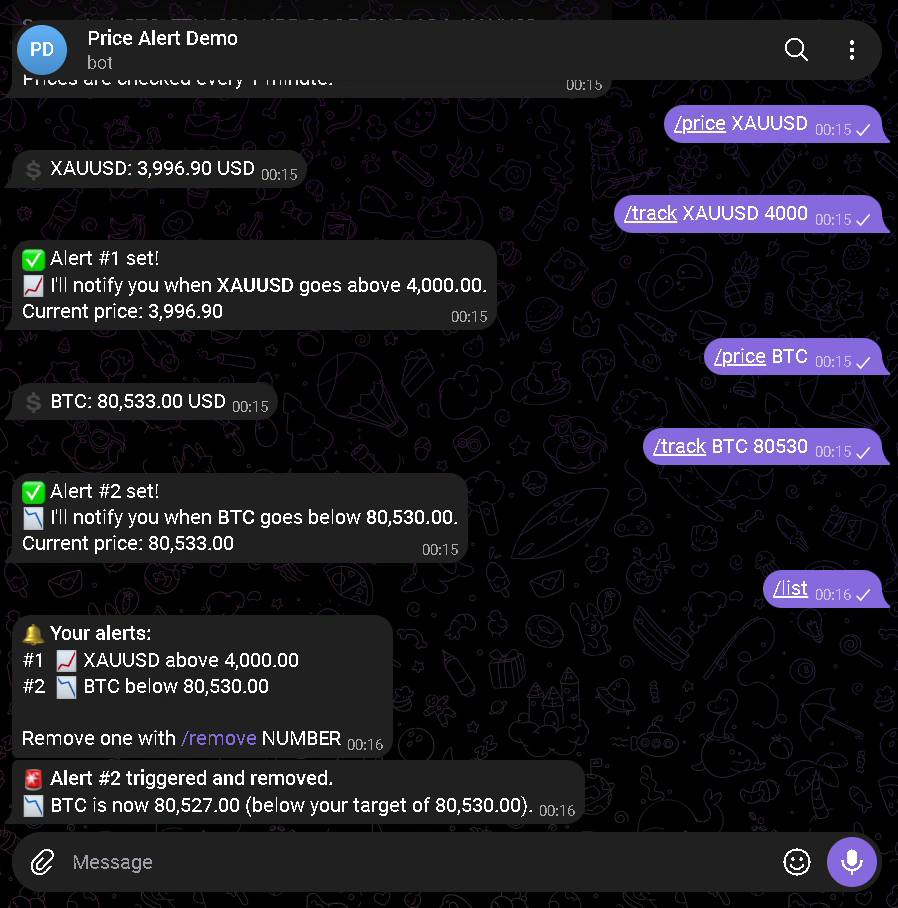
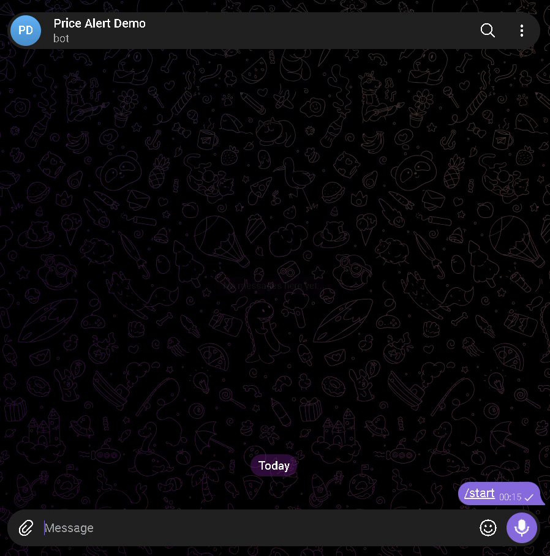
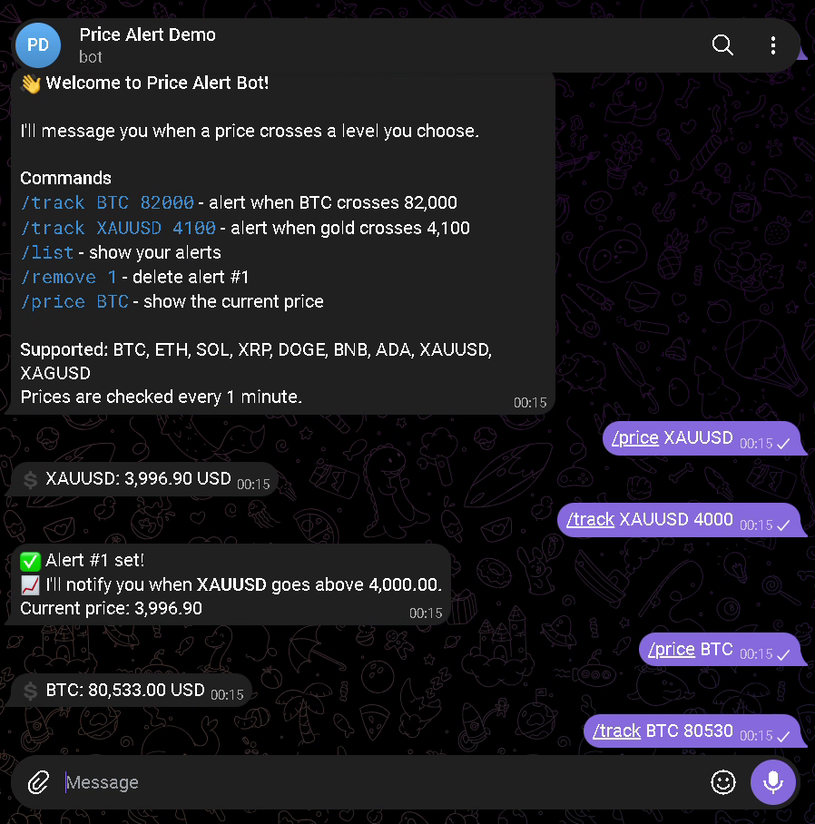
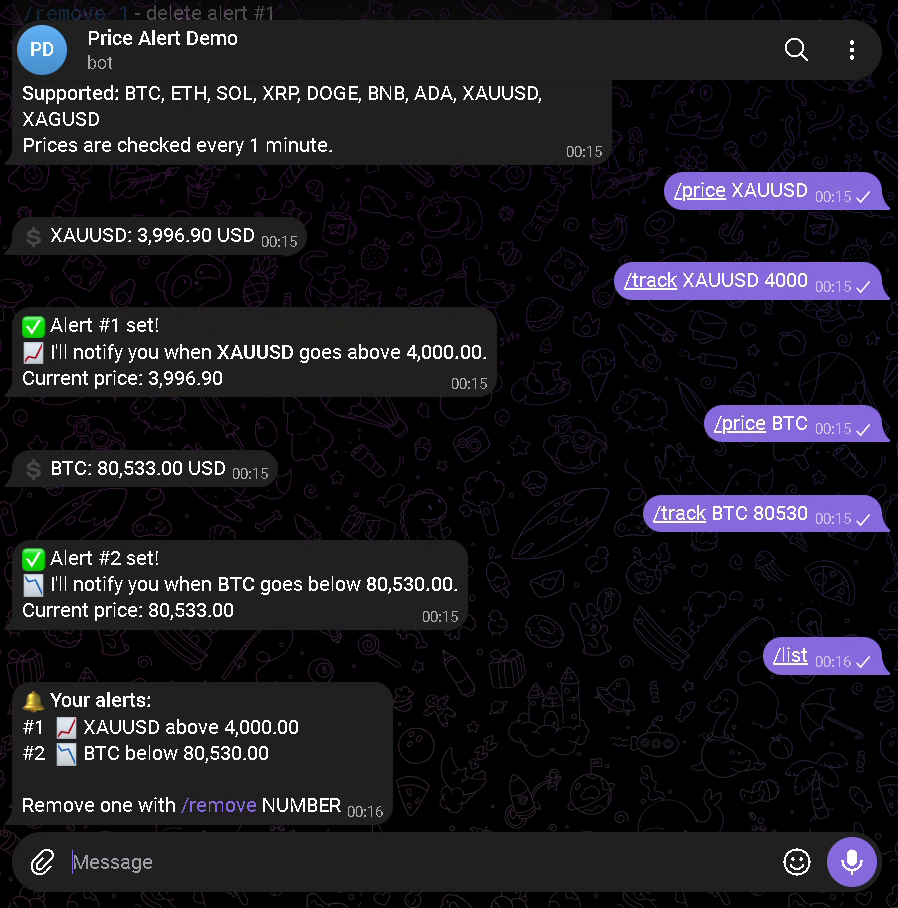
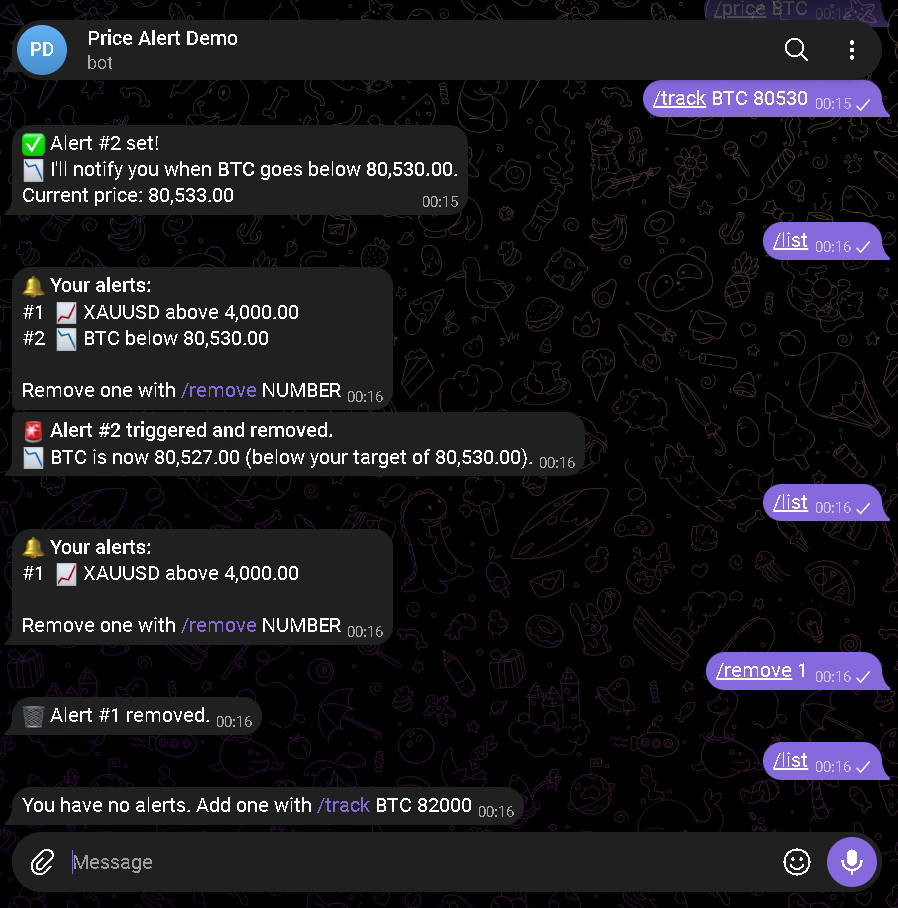

# 📈 Telegram Price Alert Bot

A Telegram bot that watches crypto and gold prices and messages you the moment a price crosses a level you set.

Built with Python, [python-telegram-bot](https://python-telegram-bot.org/), and SQLite. It uses **free price APIs only**, with no paid keys.




https://github.com/user-attachments/assets/1864d24f-beb1-4ed1-be55-177b4840bb7a


---

## ✨ Features

- `/track BTC 82000`: get alerted when Bitcoin crosses $82,000 (up **or** down)
- `/track XAUUSD 4100`: alerts for gold (and silver with `XAGUSD`)
- `/list`: see all your active alerts
- `/remove 1`: delete alert #1
- `/price BTC`: check the current price
- Prices are checked automatically every few minutes
- Alerts are stored in a local SQLite database, so they survive restarts
- Multi-user: each user only sees and manages their own alerts, numbered #1, #2, … per user
- Reliable: messages are retried if the connection drops, and an alert is only kept once its confirmation is delivered

**Supported symbols:** BTC, ETH, SOL, XRP, DOGE, BNB, ADA, XAUUSD (gold), XAGUSD (silver)

---

## 📸 Screenshots

| Welcome / Help | Setting alerts | Listing alerts |
|---|---|---|
|  |  |  |

| Alert triggered | Removing an alert |
|---|---|
|  |  |

---

## 🚀 Setup (Windows)

### 1. Create a bot and get a token
1. Open Telegram and message **[@BotFather](https://t.me/BotFather)**
2. Send `/newbot` and follow the prompts
3. Copy the token it gives you (looks like `123456789:ABCdef...`)

### 2. Install
```powershell
git clone <your-repo-url>
cd price-alert-bot

python -m venv .venv
.\.venv\Scripts\activate
pip install -r requirements.txt
```

### 3. Configure
```powershell
copy .env.example .env
```
Open `.env` and replace `paste-your-token-here` with your bot token.

### 4. Run
```powershell
python bot.py
```
Open your bot in Telegram and send `/start`.

> **macOS/Linux:** use `source .venv/bin/activate` and `cp .env.example .env`.

---

## 🗂️ Project structure

| File | Purpose |
|---|---|
| `bot.py` | Main bot: commands and the scheduled price checker |
| `prices.py` | Fetches prices from Binance (crypto, with CoinGecko backup) and gold-api.com (metals) |
| `database.py` | Saves, lists, and deletes alerts in SQLite (`alerts.db`) |
| `.env.example` | Template for your secret settings |
| `requirements.txt` | Python dependencies |

---

## ⚙️ How it works

1. When you `/track`, the bot fetches the current price and records whether the target is **above** or **below** it.
2. Every `CHECK_INTERVAL_MINUTES` (default 3), a background job fetches prices for all tracked symbols in one batch.
3. If a price has crossed its target, you get a message like *"Alert #3 triggered and removed."* The alert is removed only after that message is delivered. If delivery fails, it's retried on the next check.
4. Any error is logged to the console and to `bot.log`.

## 🔒 Security

Your bot token lives only in `.env`, which is listed in `.gitignore` and never committed.

## 📊 Data sources

| Asset | Source | Freshness |
|---|---|---|
| Crypto (BTC, ETH, …) | [Binance public market data](https://developers.binance.com/docs/binance-spot-api-docs/rest-api/market-data-endpoints) (USDT pairs) | Real-time: latest trade on Binance |
| Crypto (backup) | [CoinGecko](https://www.coingecko.com/en/api), used only if Binance is unreachable | About 1 minute behind, averaged across exchanges |
| Gold, silver | [gold-api.com](https://gold-api.com/) spot price | Refreshed every 30 seconds, per gold-api.com; the underlying data providers aren't named. Flat on weekends, when the metals market is closed |

All sources are free and need no API key. The bot checks every few minutes anyway, so any source delay is small next to the check interval.
